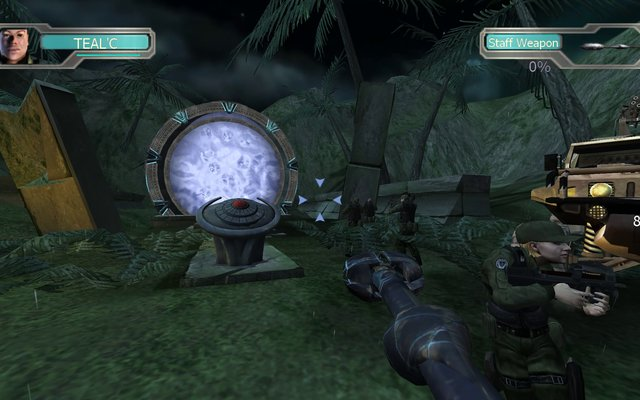
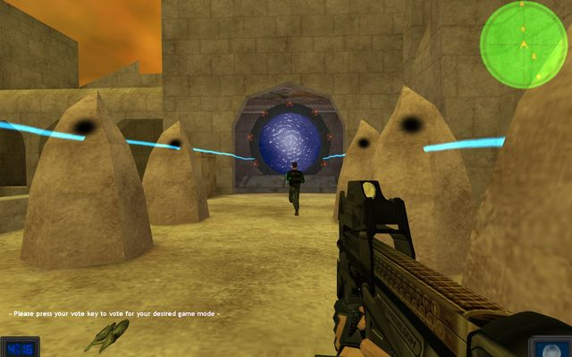
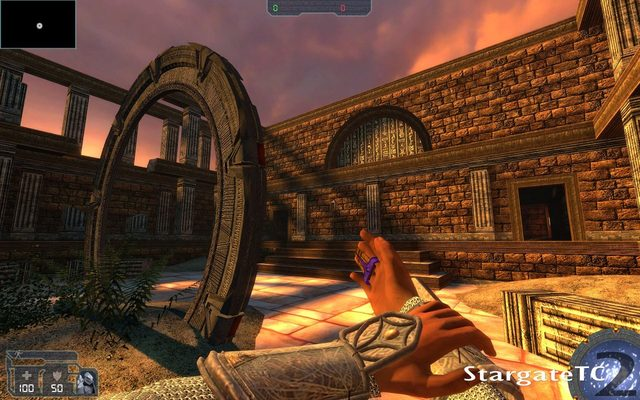
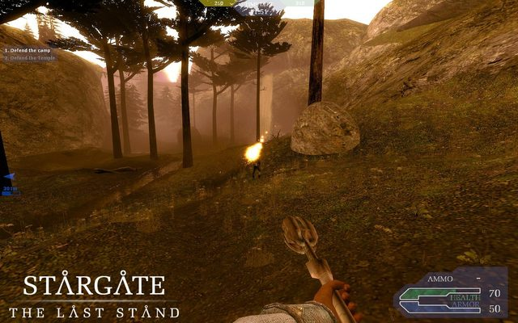
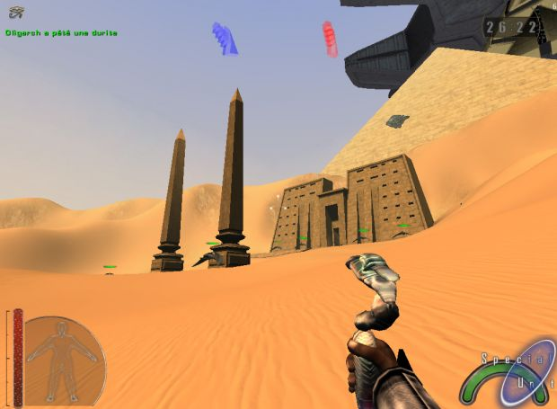

# Stargate Redial

 **[English](#english)** &nbsp;·&nbsp;  **[Français](#francais)**

<b>🆕 <a href="https://github.com/Stargate-Redial/alliance-redial">Stargate SG-1: The Alliance: Redial</a></b> The unreleased 2005 SG-1 game, playable on PC · <a href="https://stargatedatabase.link/en/games/alliance/">Download &amp; guide</a> · <a href="https://stargatedatabase.link/fr/jeux/alliance/">Page en français</a>

|  |  |  |  |
|:---:|:---:|:---:|:---:|
| **[StargateTC: Redial](https://github.com/Stargate-Redial/stargatetc-redial)** | **[StargateTC 2: Redial](https://github.com/Stargate-Redial/stargatetc2-redial)** | **[Stargate TLS: Redial](https://github.com/Stargate-Redial/stargatetls-redial)** | **[Special Unit: Redial](https://github.com/Stargate-Redial/specialunit-redial)** |
| StargateTC 2.0 · Half-Life | StargateTC 2 · Source SDK Base 2006 | Stargate: The Last Stand · Source SDK Base 2007 | Special Unit · Unreal Tournament 2004 |
| `connect 92.222.243.147:27030` | `connect 92.222.243.147:27032` | `connect 92.222.243.147:27031` | `open 92.222.243.147:7810` |

**Discord:** [discord.com/invite/SgHPP4mZyB](https://discord.com/invite/SgHPP4mZyB)

---

##  English

Stargate games and mods brought back to life on today's PCs, with bots that play the objectives and servers running 24/7.

- **[Stargate SG-1: The Alliance: Redial](https://github.com/Stargate-Redial/alliance-redial) (new):** the official SG-1 game cancelled in 2005, now playable on PC as a native port on the Unreal Tournament 2004 engine: the whole campaign voiced by the show's cast, multiplayer with bots and 24/7 servers (*Multi-Player → Internet → Find Match*), automatic updates. [Download and install guide](https://stargatedatabase.link/en/games/alliance/).
- **[StargateTC: Redial](https://github.com/Stargate-Redial/stargatetc-redial):** StargateTC 2.0, the Half-Life mod, runs again on today's Half-Life. Its bots dial the gates, ride the rings, carry the key to the bomb and plant C4.
- **[StargateTC 2: Redial](https://github.com/Stargate-Redial/stargatetc2-redial):** bots for StargateTC 2, and an in-game server browser that lists servers again.
- **[Stargate TLS: Redial](https://github.com/Stargate-Redial/stargatetls-redial):** bots for Stargate: The Last Stand, which attack and defend the objectives.
- **[Special Unit: Redial](https://github.com/Stargate-Redial/specialunit-redial):** Special Unit, the Unreal Tournament 2004 mod, runs again on today's UT2004. Its bots attack and defend the objectives, carry the crystals, ride the rings and fly the ships.

Each project has a one-click Windows installer in its Releases. Bots fill your own games, and they leave as players join the 24/7 servers above. Come and say hello on the [Discord](https://discord.com/invite/SgHPP4mZyB).

---

##  Français

Les jeux et mods Stargate qui reprennent vie sur les PC d'aujourd'hui, avec des bots qui jouent les objectifs et des serveurs ouverts 24h/24.

- **[Stargate SG-1: The Alliance: Redial](https://github.com/Stargate-Redial/alliance-redial) (nouveau) :** le jeu SG-1 officiel annulé en 2005, désormais jouable sur PC en portage natif sur le moteur d'Unreal Tournament 2004 : toute la campagne avec les voix de la série, le multijoueur avec des bots et des serveurs 24h/24 (*Multi-Player → Internet → Find Match*), des mises à jour automatiques. [Téléchargement et guide d'installation](https://stargatedatabase.link/fr/jeux/alliance/).
- **[StargateTC: Redial](https://github.com/Stargate-Redial/stargatetc-redial) :** StargateTC 2.0, le mod de Half-Life, retourne sur le Half-Life d'aujourd'hui. Ses bots composent les portes, prennent les anneaux, portent la clé jusqu'à la bombe et posent du C4.
- **[StargateTC 2: Redial](https://github.com/Stargate-Redial/stargatetc2-redial) :** des bots pour StargateTC 2, et un navigateur de serveurs du jeu qui affiche de nouveau les serveurs.
- **[Stargate TLS: Redial](https://github.com/Stargate-Redial/stargatetls-redial) :** des bots pour Stargate: The Last Stand, qui attaquent et défendent les objectifs.
- **[Special Unit: Redial](https://github.com/Stargate-Redial/specialunit-redial) :** Special Unit, le mod d'Unreal Tournament 2004, retourne sur l'UT2004 d'aujourd'hui. Ses bots attaquent et défendent les objectifs, portent les cristaux, prennent les anneaux et pilotent les vaisseaux.

Chaque projet a un installeur Windows en un clic dans ses Releases. Les bots remplissent vos propres parties, et ils cèdent leur place aux joueurs sur les serveurs 24/7 ci-dessus. Venez dire bonjour sur le [Discord](https://discord.com/invite/SgHPP4mZyB).

---

*Made with love by [@CreepyInpu](https://x.com/CreepyInpu). A fan project, not affiliated with the games' and mods' teams, Valve, Epic Games or MGM. Screenshots: StargateTC and Stargate SG-1: The Alliance by CreepyInpu; StargateTC 2, The Last Stand and Special Unit from the mods' ModDB pages.*
